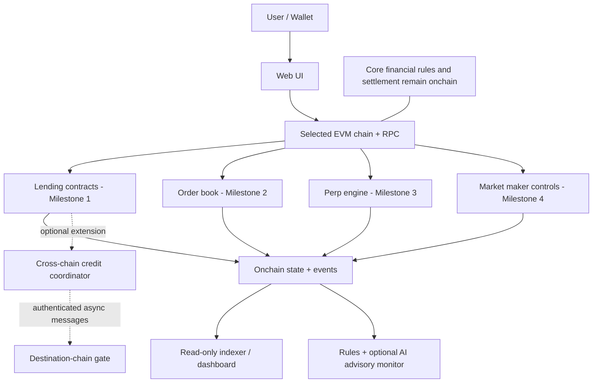

# AUREX Onchain Markets — V4 Final Build Specification

**Release:** V4.0.0  
**Status:** Final pre-development specification for a hackathon prototype. Not an audit, not a production deployment, and not a claim that any module has already been implemented.

## 1. The actual problem we are solving

The supplied challenge asks us to build a fully onchain financial product that uses blockchain settlement to create transparent trading or lending markets without relying on centralized offchain infrastructure for the core financial mechanism.

AUREX must therefore demonstrate, through working smart contracts and verifiable transactions, that critical financial rules, accounting, and settlement can be enforced onchain. The project is **not** a company-launch plan, broad DeFi ecosystem, token launch, governance system, or AI product.

**Product thesis:** make financial-market rules inspectable and enforceable at the point of execution—not merely visible in a dashboard.

## 2. Four committed implementation milestones

All four directions are part of the long-term build. They are implemented sequentially, tested individually, and integrated into one application.

1. **Credit-history-aware lending** — verified onchain repayment history, deterministic credit terms, borrowing, repayment, exposure accounting.
2. **Fully onchain order book** — escrowed orders, deterministic matching, cancellation, atomic settlement.
3. **Perpetual futures** — margin, positions, funding-index accounting, PnL, liquidation and bad-debt controls.
4. **Onchain market making** — inventory/capital bounds and quote validation integrated with the order book.

Each milestone has a separate financial state machine and risk checks. The shared infrastructure must not collapse their accounting into one generic market engine.

## 3. Supporting models, not the core product

- **Cross-chain coordination:** a supporting extension. Design the interfaces and safety model now; use a mock adapter for early development. A live route is enabled only after exact-chain/provider configuration and end-to-end tests. It is not required to prove the initial single-chain market.
- **AI risk monitoring:** a supporting, advisory layer. Deterministic rules are the first baseline. An ML anomaly model is optional until a defensible dataset and evaluation exist. AI cannot determine authoritative credit eligibility, move funds, change policy, consume/release reservations, or liquidate.
- **Indexer and web UI:** presentation and read-model components. Contracts remain the financial source of truth.
- **Copyright recognition service, tokenomics, DAO/governance, broad ecosystem features, and company operations:** out of scope for this prototype unless a concrete requirement is added later.

## 4. Architecture at a glance



Read `docs/ARCHITECTURE.md` for full component diagrams, sequence flows, security invariants, and acceptance gates.

## 5. Release principles

1. **Build in sequence; design for integration.** Milestones are not four disconnected demos.
2. **Do not overclaim decentralization.** UI, indexing, AI, and message relays may be offchain, but they must not be the authority for core financial state transitions.
3. **Mock honestly.** Every simulated provider, route, oracle, or model must be labelled simulated in the UI and pitch.
4. **No invented facts.** Do not invent chain support, addresses, test results, model metrics, or transaction hashes.
5. **No silent scope creep.** No new product subsystem unless it supports the problem statement, a milestone acceptance criterion, or a necessary security property.
6. **Security before breadth.** A market is not complete until its invariant and failure-path tests pass.
7. **Testnet only.** Use test tokens. No production funds, mainnet claim, or financial-return promise.

## 6. Document map

- `docs/ARCHITECTURE.md` — master architecture and challenge traceability.
- `docs/BRD.md` — business/problem requirements, framed around the challenge rather than company building.
- `docs/PRD.md` — product scope and milestone outcomes.
- `docs/TRD.md` — technology and system boundaries.
- `docs/SRS.md` — functional/non-functional requirements.
- `docs/CONTRACTS_AND_INTERFACES.md` — contract responsibilities and interfaces.
- `docs/WORKFLOWS.md` — user and protocol transaction flows.
- `docs/SCHEMA.md` — identifiers, event model, and read-model schema.
- `docs/SECURITY_THREAT_MODEL.md` — threats and invariants.
- `docs/TEST_AND_ACCEPTANCE.md` — test strategy and release gates.
- `docs/SCOPE_AND_ACCEPTANCE_MATRIX.md` — what counts as done per milestone.
- `docs/ROADMAP.md` — implementation sequence and integration plan.
- `docs/CROSS_CHAIN.md` — optional cross-chain extension and asynchronous failure model.
- `docs/AI_MONITORING.md` — supporting monitoring architecture and AI authority limits.
- `docs/DEPLOYMENT_AND_OPERATIONS.md` — testnet deployment and operating runbook.
- `docs/ADR.md` — decisions and gated choices.
- `docs/AI_AGENT_HANDOFF.md` — implementation rules for teammates and coding agents.
- `docs/V4_RELEASE_CHECKLIST.md` — final release decisions and pre-demo checklist.

## 7. Repository shape

```text
src/
  core/           # shared roles, pause controls, interfaces
  lending/        # Milestone 1
  orderbook/      # Milestone 2
  perps/          # Milestone 3
  marketmaking/   # Milestone 4
  crosschain/     # supporting extension; adapter and coordinator
  monitoring/     # optional onchain attestation registry
script/
test/
  unit/
  fuzz/
  invariant/
  integration/
  crosschain/
ai-monitor/       # advisory service; never financial authority
web/              # wallet UI and read-only dashboard
docs/
```

## 8. Choices deliberately gated until development

These choices must be resolved before the relevant code is deployed; the docs do not invent values:
- Exact EVM chain/testnet and RPC configuration.
- Test token contract, decimals, and faucet availability.
- Credit formula, score inputs, caps, loan duration, fees, and default handling.
- Trusted source and verification method for accepted repayment history.
- Order-book price/quantity representation, precision, fee model, and bounded matching limits.
- Perpetual funding formula, oracle, leverage caps, liquidation incentive, and bad-debt backstop.
- Market-maker operator model, quote limits, inventory caps, and capital source.
- Cross-chain provider and exact supported route (only if live cross-chain work is activated).
- AI dataset, threshold calibration, and evaluation metrics (only if ML is activated).

## 9. Agent and teammate rules

Every contributor must read this file and `docs/ARCHITECTURE.md`, implement only the active milestone, preserve existing invariants, add tests, and report actual commands/results. Never claim a mocked route is live, a model is accurate without evaluation, or a market is implemented without its acceptance suite.

**Definition of V4:** the final coherent plan for building one integrated four-market onchain product in four sequential milestones, with cross-chain coordination and AI monitoring retained as supporting models rather than the center of the product.
